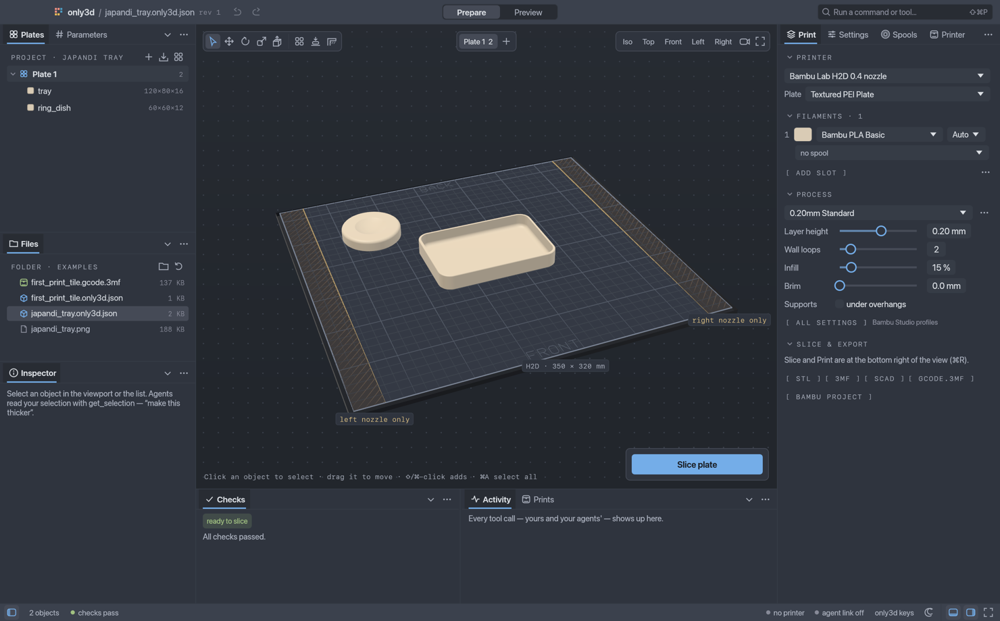

# only3d

3D modelling, slicing and printing for Bambu Lab printers and hundreds of others, built for AI
agents. Written in Rust.

Every action is a tool. The desktop app, the CLI and the MCP server all call the same tools. Your
agent can design a part, check it, slice it and watch it print, and you see each step live in
the app.



## Download

Get the latest build from [Releases](https://github.com/onatyap/only3d/releases): a `.dmg` for
macOS (Apple silicon and Intel), an installer or a zip for Windows, and an AppImage or a `.deb`
for Linux. Windows and Linux have x64 and ARM64 builds. The builds aren't signed yet, so macOS
and Windows ask you to allow them the first time; the release notes say how. The Windows
installer also puts `only3d` on your PATH.

Then connect your agent: **only3d ▸ Connect an Agent** in the app, or
`only3d mcp install claude-code` (or codex, gemini, antigravity, opencode, kimi, cursor, skill).

### Build from source

```bash
git clone https://github.com/onatyap/only3d && cd only3d
cargo install --path crates/only3d
only3d mcp install claude-code     # or codex, gemini, antigravity, opencode, kimi, cursor, skill
only3d                              # opens the app; agents attach to it live
```

On Linux, install the build packages first (Debian and Ubuntu names): `pkg-config
libxkbcommon-dev libwayland-dev libx11-dev libxcb1-dev libgl1-mesa-dev libdbus-1-dev`.

Or ask your agent: *"Install only3d from github.com/onatyap/only3d and add it as an MCP server."*

## Use

Ask for a part: *"Make a 60 × 30 mm tray with 2 mm walls and slice it for PETG."* The agent
builds a parametric model, renders and checks it, then slices it with Bambu's own presets and
machine G-code for your printer.

- **Projects** are plain JSON (`*.only3d.json`). Sizes can be expressions over named
  parameters, so changing one value updates the whole model.
- **Import** STL, OBJ, 3MF, STEP or OpenSCAD. A `.scad` file's variables become editable
  parameters (needs OpenSCAD).
- **Export** STL, OBJ, 3MF, `.scad`, `.gcode.3mf`, or a Bambu Studio project.
- **Printer actions** (start, stop, filament, heaters) wait for you to approve them in the app.

`only3d tools --brief` lists the API. The [guide](docs/guide.md) covers the rest.

## Working on this repo

Agents: start with [CLAUDE.md](CLAUDE.md) (rules, commands, layout).
[SKILL.md](.claude/skills/only3d/SKILL.md) teaches an agent to use only3d well. Copy it to
`~/.claude/skills/` to use it in any project.

## Status

Early. Used daily on macOS; the Windows and Linux builds are new and lightly tested.
- Printers: every Bambu Lab printer, and about 450 printers of 70 other makers through
  OrcaSlicer's profiles, slice with their own presets and G-code. Klipper (Moonraker), OctoPrint
  and PrusaLink printers print over the network. Prints have been run on the H2D only;
  [docs/printers.md](docs/printers.md) lists how far each printer is tested, and the app warns
  before the first print on an untested one.
- Single-filament plates slice natively and have been printed. Multi-filament plates slice
  natively too but haven't been printed yet; `export_bambu_project` hands a plate to Bambu
  Studio instead.
- Starting a print from only3d needs the printer in LAN-only mode with Developer Mode on.
- macOS only for now: opening a plate in Bambu Studio from only3d, and previews of PDFs and
  documents. Optional extras: OpenSCAD for `.scad` files, ffmpeg for the printer camera.

## License

AGPL-3.0-or-later. Includes Bambu Studio's printer profiles (AGPL-3.0). only3d isn't affiliated
with Bambu Lab.
